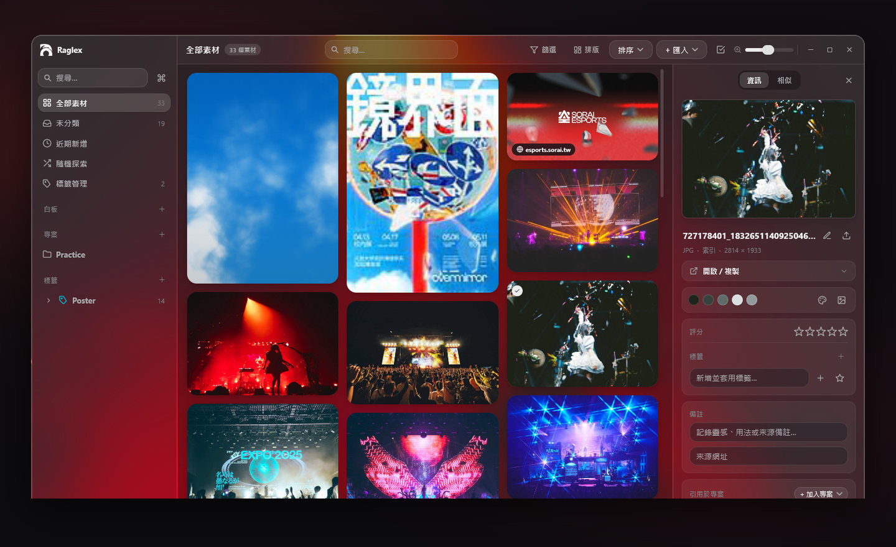
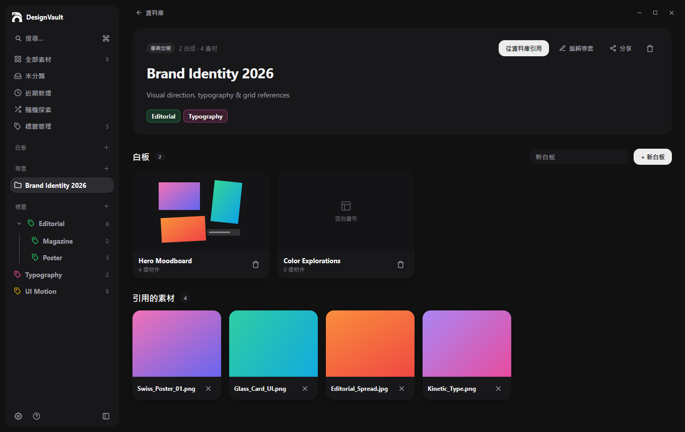
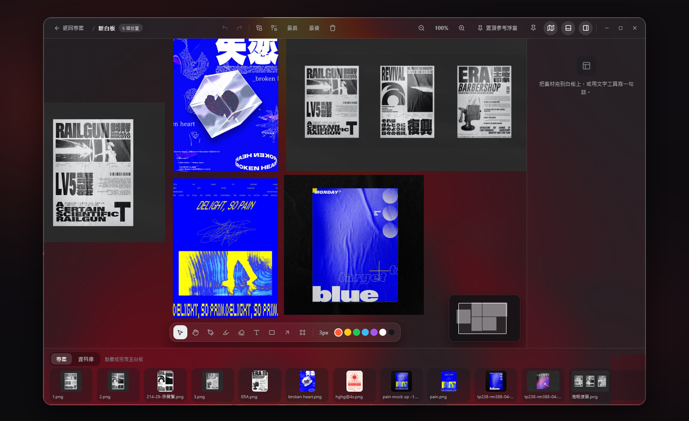
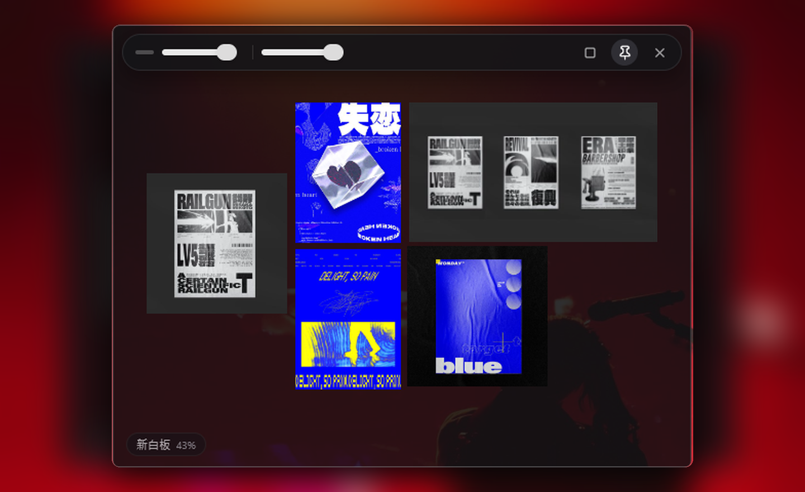

  

  <a href="README.md">English</a> &nbsp;·&nbsp;
  <a href="README.zh-TW.md">繁體中文</a> &nbsp;·&nbsp;
  <a href="README.ja.md"><strong>日本語</strong></a>

  
  
  
  
  
  

## プレビュー

| すりガラスライブラリ＆インスペクタ | プロジェクト＆ボード一覧 |
| :---: | :---: |
|  |  |

| 無限ムードボード | 最前面リファレンスウィンドウ |
| :---: | :---: |
|  |  |

---

## Raglex とは？

**Raglex** は、クリエイターとデザイナーのための高速ネイティブ・ビジュアルアセット管理＆無限ムードボードスタジオです。**100% ローカル優先**設計で、すべてのインデックス・フォルダ・タグ・ボードはローカルの単一 `bbolt` データベースに保存されます。

**Go** と **[MyGo Native UI](https://github.com/egoist/mygo)**（`CGO_ENABLED=0`）で構築され、**macOS（Apple Silicon / Intel）**、**Windows（x64 / ARM64）**、**Linux（x64 / ARM64）** で軽快に動作。**日本語**・**繁體中文**・**English** の3言語に完全対応しています。

---

## 主な機能

### 並列フォルダ・階層タグ・バージョンスタック
- **並列フォルダ＆タグ階層**：左下のスイッチャーから「フォルダ｜タグ」をスムーズに切り替え。多層サブフォルダ、カラー継承、ドラッグ分類、フォルダ一括削除（サブフォルダ含む）、ローカルフォルダの階層ミラーインポートに対応。
- **4つの保存方式**：**インデックス（元ファイルを複製しない）**、**シンボリックリンク**、**移動**、**コピー**から選択可能。サイドバー上部のクイックフィルタ表示も環境設定から自由にカスタマイズできます。
- **3種類のレイアウト＆スタック（`Ctrl+G`）**：**Bento**、**ウォーターフォール**、**グリッド**をワンクリック切替。`v1 / v2 / final` のような差分アセットをスタックにまとめて管理できます。

### Raglex Cloud・フォルダ選択同期・コラボスペース（v0.4.0）
- **20 GB クラウドストレージ＆高速同期**：**Raglex Cloud**（または自前 Docker の **Self-Host** サーバー）で 6-Worker HTTP/2 並列同期に対応。アカウント画面で 20 GB の使用量ゲージを確認できます。
- **フォルダ選択同期**：`環境設定 → 同期とコラボ` で同期するフォルダを個別にオン／オフでき、不要なフォルダを除外して容量を節約できます。
- **フレンドコラボスペース（`CLB-XXXX-XXXX`）**：フォルダやプロジェクトを共有し、みんなでリファレンスを集められます。**ボードは個人所有制**のため、各自が自分のボードのみ編集でき、他メンバーのボードは競合なく閲覧できます。
- **公開共有コード（`SHR-XXXX-XXXX`）＆直接転送**：アカウント不要でダウンロードできる公開共有コードや、同一 Wi-Fi / 6桁 E2E 暗号化転送に対応。

### ネイティブ形式プレビュー＆ボーダーレス Markdown デスク
- **Markdown 閲覧・編集デスク**：枠のないミニマルな閲覧／分割／編集モード、段落フォーカス、テーブル、チェックボックス、`Ctrl+S` 保存に対応。
- **フォント・音声・SVG・PDF・動画**：フォント見本（`.ttf`/`.otf`）、96本波形シークバー（`.wav`/`.mp3`/`.flac`）、無損失 SVG ズーム、PDF ページ閲覧、内蔵 `ffmpeg` 動画再生に対応。
- **無限ボード＆最前面リファレンス窓**：ペン・マーカー・矢印・セクション枠を備えたボードを、背景透過＆クリック透過対応の最前面ウィンドウとして表示できます。

### ローカル AI・Eagle Import・MCP・拡張機能
- **オフライン類似画像検索＆カラー検索**：128次元ビジュアルベクトル・pHash/dHash・OKLab 5色パレット検索を完全オフラインで実行。
- **公式 Eagle Import プラグイン**：`+ インポート → Eagle からインポート` から `.library` や `.eaglepack` を階層・タグ・Webブックマーク付きでインポート。
- **MCP サーバー（17ツール）＆ブラウザ拡張**：AI アシスタント連携や、アプリ終了中でも保存できるオフライン受信フォルダ対応の Chrome / Edge / Firefox 拡張を提供。

---

## 対応プラットフォーム

[GitHub Releases](../../releases) からお使いのプラットフォーム向けバイナリをダウンロードできます（macOS Apple Silicon / Intel、Windows x64 / ARM64、Linux x64 / ARM64）。

## ライセンス

**[Mozilla Public License 2.0 (MPL-2.0)](LICENSE)** の下で公開されています。
