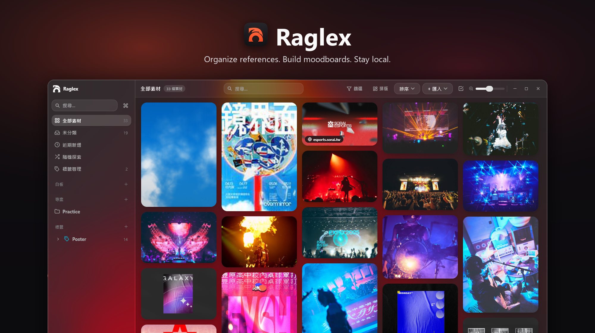

<p align="center">
  
</p>

<p align="center">
  <a href="README.md">English</a> &nbsp;·&nbsp;
  <a href="README.zh-TW.md">繁體中文</a> &nbsp;·&nbsp;
  <a href="README.ja.md"><strong>日本語</strong></a> &nbsp;·&nbsp;
  <a href="https://raglex.sorai.tw">公式サイト</a> &nbsp;·&nbsp;
  <a href="https://raglex.sorai.tw/docs">ドキュメント</a>
</p>

<p align="center">
  <a href="LICENSE"></a>
  <a href="https://github.com/Batkixni/Raglex/stargazers"></a>
  
  
  
  
</p>

<div align="center">
  <a href="https://awesomemygo.dev/apps/raglex">
    
  </a>
</div>

<p align="center">
  <strong>Go + MyGo で構築されたオープンソース・100% ネイティブのデジタルアセット管理、ローカル AI 類似画像検索、無限リファレンスボード。</strong><br/>
  Electron 不使用。コピー不要のインデックス方式。テレメトリゼロ。ファイルは常にあなたのディスクに留まります。
</p>

---

## ワークスペース・プレビュー

| ネイティブ・ライブラリ & インスペクタ | プロジェクト空間 & ボードプレビュー |
| :---: | :---: |
|  |  |

| 無限リファレンスボード | 最前面フローティング参照ウィンドウ |
| :---: | :---: |
|  |  |

---

## 主な特徴

### 1. 100% ネイティブ高速動作（Electron 不使用）
- **Go + [MyGo](https://github.com/egoist/mygo)** と組み込み **bbolt** による **約 21 MB の単一ネイティブバイナリ**。瞬時の起動と極めて低いメモリ消費を実現。
- ビューポート仮想化により数万件のアセットでも滑らかにスクロール。
- 各 OS のネイティブ表現に最適化（Windows 11 Acrylic & Snap Layouts / macOS Vibrancy & ネイティブウィンドウボタン / Linux）。

### 2. 非破壊「インデックス方式」— ファイルは複製せずそのまま管理
- **デフォルトの `Index` モードでは元ファイルを一切コピー・移動しません。** ストレージの二重消費や独自フォーマットへのロックインを回避します。
- 用途に応じて **Index / Symlink / Copy / Move** の 4 方式から選択可能。
- 削除時はデフォルトでディスク上の元ファイルを保持し、本当に削除したい場合のみモーダル内で **「ディスク上の元ファイルも完全に削除する」** にチェックを入れる安全設計です。

### 3. 無限リファレンスボード & 最前面フローティング参照ウィンドウ
- GPU アクセラレーション対応の無限キャンバス。画像配置、グループ、フレーム、フリーハンド描画、矢印、複数行メモに対応。
- ワンクリックで半透明の **最前面フローティング参照ウィンドウ**（不透明度・ズーム・グレースケール切替）として切り出し、Blender・Photoshop・Figma・CLIP STUDIO での制作を強力にサポートします。

### 4. ローカル視覚 AI Embedding 類似検索・カラーパレット・オフライン自動タグ
- **端末内ビジュアル AI Embedding**：画像特徴ベクトルと知覚ハッシュをローカルで計算し、**類似画像検索・画像からの検索**を完全オフラインで実行。
- **OKLab 代表カラー抽出**：各アセットから 5 色パレットを自動抽出し、HEX コピーや色調フィルタリングに対応。
- **ローカル AI 自動タグ付け（Ollama / Laya 連携・任意）**：ローカルのビジョンモデルと接続し、画像を外部クラウドに送らずタグ候補を提案します。

### 5. 階層フォルダ・階層タグ・スタック・幅広いクリエイティブ形式
- 8 色継承に対応した **並列階層フォルダ** と **階層タグ**、バージョン **スタック**、自動取り込みの **監視フォルダ（Watch Folders）**、プレビュー＆元に戻す対応の **一括リネーム**。
- **Bento / Masonry / Grid** 表示、`Space` クイックルック、動画（**静的 `ffmpeg` 同梱**）、カメラ RAW（`CR3`/`ARW`/`NEF`/`RAF`/`NAF`/`DNG`）、SVG、フォント、音声、PDF をネイティブ表示。

### 6. ブラウザ拡張機能（Chrome / Edge / Brave / Arc / Firefox / Zen）
- 右クリックで元 URL・タイトル付き保存、ページ内画像の一括収集、Raglex 未起動時でも保存できる **オフライン受信トレイ** に対応。
- 詳細ガイド：[`docs/BROWSER_EXTENSION.md`](docs/BROWSER_EXTENSION.md) · オンラインドキュメント：[raglex.sorai.tw/docs](https://raglex.sorai.tw/docs#extension)

### 7. Self-Host ゼロ知識 E2E 暗号化同期 & 6 桁 P2P 転送
- Docker（`deploy/docker-compose.yml` + `raglex-server`）で自宅 NAS や VPS に自分専用の同期サーバーを 1 コマンドで構築可能（**Cloudflare R2 / S3 / MinIO**、モバイル `/mobile` PWA、MCP サーバー対応）。
- **AES-256-GCM ゼロ知識エンドツーエンド暗号化がデフォルト有効**：端末内でランダムな 256-bit AES キー（`rglx-aes256-...`）を自動生成し、ファイル本体・ファイル名・タグ・フォルダ・メモを暗号化してからアップロードします。キーファイル保存／読み込みで他端末でも安全に復号可能。
- **フォルダ選択同期**、**超軽量差分自動同期**（待機ポーリング約 150 B）、**6 桁コード P2P 暗号化転送** を標準搭載。
- 詳細ガイド：[`docs/SELF_HOST.md`](docs/SELF_HOST.md) · オンラインドキュメント：[raglex.sorai.tw/docs](https://raglex.sorai.tw/docs#self-host)

### 8. オープン・プラグインマーケット & ローカル API / MCP
- 標準 stdin/stdout JSON プロトコルであらゆる言語からプラグイン開発可能（[`docs/PLUGIN_SDK.md`](docs/PLUGIN_SDK.md)）。コミュニティ PR レジストリ [`Batkixni/raglex-plugins`](https://github.com/Batkixni/raglex-plugins) から 1 クリック導入。
- 公式オプションプラグイン：**Eagle Import**、**Smart Duplicate Finder**、**Color Palette Exporter (CSS/JSON)**、**Auto Aspect Ratio & Resolution Tagger**、**Markdown Notes** など。
- Access Key 認証付きローカルサーバー（厳格な localhost / 拡張機能 CORS、`HttpOnly` モバイル PWA）および AI エージェント向け **MCP サーバー** を内蔵。

---

## ダウンロード & インストール

**[GitHub Releases](https://github.com/Batkixni/Raglex/releases/latest)** または **[raglex.sorai.tw](https://raglex.sorai.tw)** からダウンロードできます：

| プラットフォーム | アーキテクチャ | パッケージ |
| :--- | :--- | :--- |
| **Windows** | x64 (`windows/amd64`) | `raglex-setup-0.5.1-amd64.exe`（インストーラ） / `Raglex-windows-amd64.zip` |
| **Windows** | ARM64 (`windows/arm64`) | `raglex-setup-0.5.1-arm64.exe`（インストーラ） / `Raglex-windows-arm64.zip` |
| **macOS** | Apple Silicon (`darwin/arm64`) | `Raglex-darwin-arm64.zip` |
| **macOS** | Intel (`darwin/amd64`) | `Raglex-darwin-amd64.zip` |
| **Linux** | x64 / ARM64 | `.deb` / `.rpm` / `.tar.gz` |
| **ブラウザ拡張** | Chromium / Firefox & Zen | `raglex-browser-extension.zip` / `raglex-firefox-extension.xpi` |
| **Self-Host CLI** | Windows / macOS / Linux | `raglex-cli-<os>-<arch>.zip`（`raglex-server` & `raglex-mcp`） |

> [!NOTE]
> **macOS Gatekeeper 警告・未署名ビルドについて（重要なお知らせ）**
> Raglex は MPL-2.0 の 100% オープンソースであり、**悪意のあるコードやテレメトリは一切含まれていません**。すべてのバイナリは GitHub Actions によって透明にビルドされ、`SHA256SUMS.txt` を公開しています。
> ただし個人開発のオープンソースプロジェクトのため、有料の Apple Developer 署名証明書を取得しておらず、**macOS では初回起動時に「開発元を確認できない／破損している」といった警告が表示されます**。動作には問題なく、`/Applications` へ配置後に以下を実行すると起動できます：
> ```bash
> xattr -cr /Applications/Raglex.app
> ```
> 未署名の配布バイナリに少しでも不安がある場合は、ソースコードをご確認のうえご自身でビルドしていただくか、ご利用をお控えいただいても全く問題ありません。

---

## ブラウザ拡張機能のインストール手順

1. **Raglex → 環境設定 → 共有 / 詳細** で **内蔵ローカルサーバー**（ポート `47595`）を有効にし、**アクセスキーをコピー** します。
2. [GitHub Releases](https://github.com/Batkixni/Raglex/releases/latest) から `raglex-browser-extension.zip`（Chrome / Edge / Brave / Arc）または `raglex-firefox-extension.xpi`（Firefox / Zen）をダウンロードします。
3. **Chromium 系**：`.zip` を展開 → `chrome://extensions`（Edge は `edge://extensions`）を開く → **デベロッパーモード** を有効化 → **パッケージ化されていない拡張機能を読み込む** で展開先フォルダを選択。
4. **Firefox / Zen**：`.xpi` をウィンドウにドラッグ＆ドロップ（または `about:debugging#/runtime/this-firefox` から `manifest.json` を読み込み）。
5. ツールバーの拡張アイコンを開き、コピーした **アクセスキー** を貼り付けて接続完了です。詳細は [`docs/BROWSER_EXTENSION.md`](docs/BROWSER_EXTENSION.md) をご覧ください。

---

## Self-Host 同期サーバー クイックスタート

```bash
git clone https://github.com/Batkixni/Raglex.git
cd Raglex/deploy
export RAGLEX_TOKEN="$(openssl rand -hex 32)"
docker compose up -d
```

**Raglex → 環境設定 → アカウント / 同期 → Self-Host** にサーバー URL と `RAGLEX_TOKEN` を入力して接続します。Caddy / Nginx の HTTPS 構成や R2 / S3 連携、E2E キーのバックアップ手順は [`docs/SELF_HOST.md`](docs/SELF_HOST.md) を参照してください。

---

## ソースからビルド

**Go 1.27+** が必要です（`CGO_ENABLED=0` でビルド可能）：

```bash
git clone https://github.com/Batkixni/Raglex.git
cd Raglex
CGO_ENABLED=0 go tool mygo build -o build/dev
```

---

## ドキュメント & プライバシー

- **公式サイト & 3 言語ドキュメント**：[raglex.sorai.tw](https://raglex.sorai.tw) · [raglex.sorai.tw/docs](https://raglex.sorai.tw/docs)
- **Self-Host ガイド**：[`docs/SELF_HOST.md`](docs/SELF_HOST.md)
- **ブラウザ拡張ガイド**：[`docs/BROWSER_EXTENSION.md`](docs/BROWSER_EXTENSION.md)
- **プラグイン SDK**：[`docs/PLUGIN_SDK.md`](docs/PLUGIN_SDK.md) · **プラグインレジストリ**：[`Batkixni/raglex-plugins`](https://github.com/Batkixni/raglex-plugins)
- **デザイン仕様**：[`DESIGN.md`](DESIGN.md) · **変更履歴**：[`CHANGELOG.md`](CHANGELOG.md) · **プライバシーポリシー**：[`PRIVACY.md`](PRIVACY.md)

## ライセンス

[Mozilla Public License 2.0 (MPL-2.0)](LICENSE) の下で公開されています。
