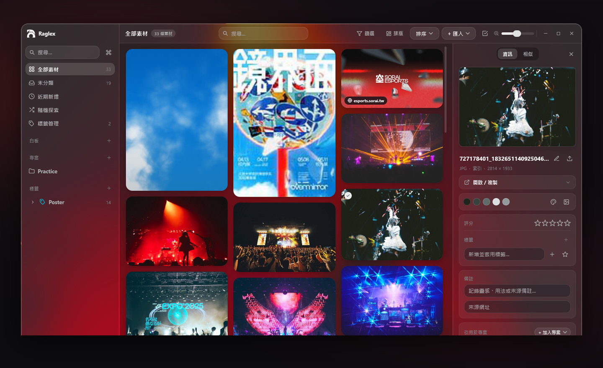
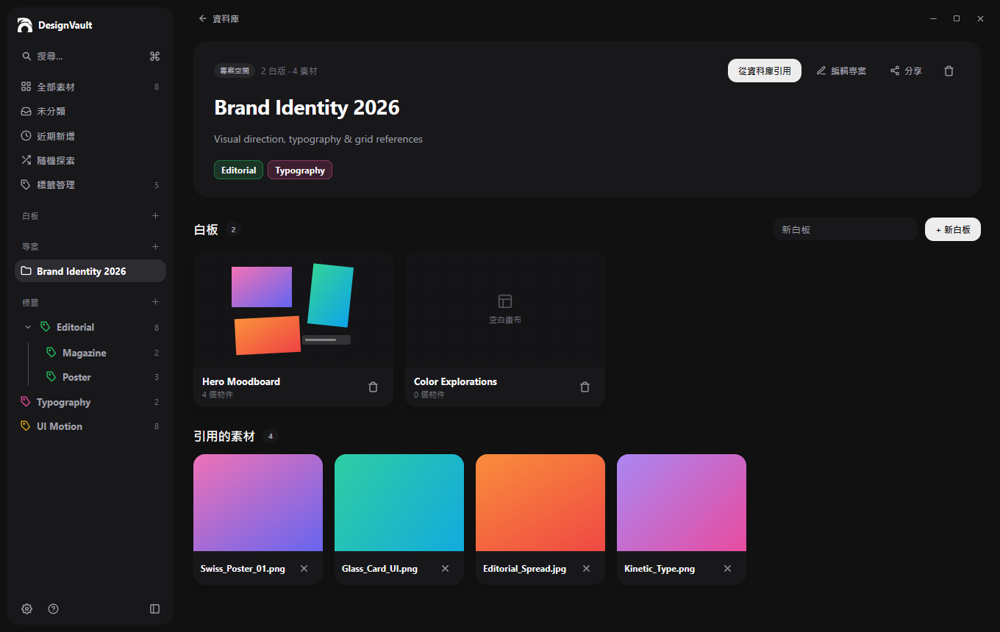

<p align="center">
  
</p>

<p align="center">
  <a href="README.md"><strong>English</strong></a> &nbsp;·&nbsp;
  <a href="README.zh-TW.md">繁體中文</a>
</p>

<p align="center">
  <a href="LICENSE"></a>
  <a href="https://github.com/Batkixni/Raglex/stargazers"></a>
  
  
  
</p>


<div align="center">
  <a href="https://awesomemygo.dev/apps/raglex">
    
  </a>
</div>

## Workspace Previews

| Frosted Glass Library & Inspector | Project Workspace & Board Previews |
| :---: | :---: |
|  |  |

| Infinite Moodboard Studio | Always-on-Top Floating Reference Window |
| :---: | :---: |
|  |  |

---

## Why Raglex?

**Raglex** is a fast, native desktop visual asset manager and infinite moodboard studio — built **100% local-first** with a **single local database** (`bbolt`) that stays completely yours on disk.

Built with **Go** and **[MyGo Native UI](https://github.com/egoist/mygo)** (`CGO_ENABLED=0`), Raglex starts instantaneously, runs smoothly across **macOS (Apple Silicon & Intel)**, **Windows (x64 & ARM64)**, and **Linux (x64 & ARM64)**, and ships as a compact portable binary.

---

## Key Features

### Visual Database & Asset Stacks
- **Flexible Storage Modes**: Import by **Index** (leave files in place), **Symlink**, **Move**, or **Copy** — backed by live filesystem watching and automatic database snapshots (`raglex.db.bak`).
- **Editorial Layouts**: Switch effortlessly between **Bento**, **Masonry**, and **Grid** views with real-time zoom, nested colored tags, star ratings, and marquee rubber-band multi-selection.
- **Asset Stacks (`Ctrl+G`)**: Fold `poster_v1` / `poster_v2` / `poster_final` or multi-angle character sheets into a single tidy stacked card, or auto-group matching filenames in one click via `Ctrl+T`. Expand anytime to compare versions side-by-side or switch versions right inside the inline viewer.

### Native Designer Format Previews
Inspect creative assets inline without leaving Raglex:
- **Fonts (`.ttf` / `.otf`)**: Live custom preview text input, `24pt / 36pt / 48pt / 72pt` size switcher, full glyph waterfall, and `Aa` specimen thumbnails.
- **Audio (`.wav` / `.mp3` / `.flac` / `.ogg` / `.m4a` / `.aac`)**: Interactive 96-bar clickable waveform scrubber, direct playback, volume control, and waveform grid thumbnails.
- **SVG Vectors (`.svg`)**: Lossless GPU vector zoom (25% – 800%) with toggleable transparency checkerboard backdrop.
- **Multi-Page PDF (`.pdf`)**: Crisp page-by-page navigation (`Prev / Next`, zoom) with automatic cover thumbnails.
- **Images & Video**: Full-stage inline viewer with zoom, animated GIF & video playback, and an **Info / Similar** Inspector sidebar.

### Moodboards & Always-on-Top Floating Reference Window
- **Standalone & Project Boards**: Create freeform infinite moodboards right from the sidebar or inside any project — drag assets, arrange groups, add sticky notes, vector arrows, section frames, pan, zoom, and rotate.
- **Always-on-Top Floating Reference Window**: Pop out any board into a frameless, always-on-top reference window with an auto-hiding HUD, adjustable **background & image opacity**, and independent pan/zoom/fit (`F`) — ideal while illustrating, modeling in 3D, or editing video.

### Batch File Manager & Productivity
- **Batch Rename (`F2`) & Undo (`Ctrl+Z`)**: Pattern-based renaming (`{name}`, `{n}`, `{date}`, `{ext}`, find/replace) with live collision-safe preview and full reversible history.
- **Batch Export & Native Clipboard**: Export selected assets in bulk, copy real OS files (`Ctrl+C`), and paste files or clipboard screenshots (`Ctrl+V`) directly into Raglex.
- **Command Palette (`Ctrl+T`)**: Instant fuzzy jump across tags, projects, boards, and power actions.

### Local AI, Visual Search & Ecosystem
- **Built-in Visual Search**: Pure-Go 128-dim visual embeddings, 64-bit pHash/dHash perceptual similarity, and 5-color OKLab palette search — works 100% offline.
- **One-Click In-App Laya / Ollaya Deployment**: Deploy and manage local open-source **Laya** decision models (`laya:multilingual`, `laya`, `winnow:e4b`) directly inside `Preferences → AI & Models` with zero terminal setup.
- **Built-in Web Server & VPS CLI (`raglex-server`)**: Share dark-mode web galleries & interactive boards over LAN from inside the app, or self-host headless on a VPS.
- **MCP Server (`raglex-mcp`)**: Connect AI coding/design agents directly to your Raglex library over Stdio or HTTP (`/mcp`).
- **Browser Companion Extension (`extensions/browser/`)**: Chrome / Edge MV3 extension with drag-to-save capsule, right-click image capture, screenshot clipping, and batch page grabber.
- **Plugin Ecosystem & GitHub Auto-Updater**: Write local plugins in any language (`examples/plugins/`) and stay up to date automatically via GitHub Releases with SHA-256 verification.

---

## Keyboard Shortcuts

| Shortcut | Action |
| :--- | :--- |
| `Ctrl+T` / `Cmd+T` | Open Go to / Command Palette |
| `Ctrl+F` / `Cmd+F` | Focus Library Search |
| `Ctrl+I` / `Cmd+I` | Import Files |
| `Ctrl+A` / `Cmd+A` | Select All Visible Assets |
| `Ctrl+G` / `Cmd+G` | Group Selected Assets into a Version Stack |
| `F2` | Batch Rename Selection |
| `Ctrl+Z` / `Cmd+Z` | Undo Last Batch Rename |
| `Ctrl+C` / `Ctrl+V` | Copy OS Files / Paste Files or Clipboard Images |
| `Space` | Open / Close Inline Asset Preview |
| `0` – `5` | Set Star Rating |
| `F` *(in Floating Ref)* | Fit All References to Window |
| `Esc` | Close Preview / Stack / Modal |

---

## Supported Platforms

| Platform | Architecture | Package |
| :--- | :--- | :--- |
| **macOS** | Apple Silicon (`darwin/arm64`) | `Raglex-darwin-arm64.zip` (`.app` bundle) |
| **macOS** | Intel x86_64 (`darwin/amd64`) | `Raglex-darwin-amd64.zip` (`.app` bundle) |
| **Windows** | x64 (`windows/amd64`) | `raglex-setup-0.3.4-amd64.exe` (Installer) / `Raglex-windows-amd64.zip` |
| **Windows** | ARM64 (`windows/arm64`) | `raglex-setup-0.3.4-arm64.exe` (Installer) / `Raglex-windows-arm64.zip` |
| **Linux** | x64 (`linux/amd64`) | `.tar.gz`, `.deb`, `.rpm`, `PKGBUILD` |
| **Linux** | ARM64 (`linux/arm64`) | `.tar.gz`, `.deb`, `.rpm`, `PKGBUILD` |

Download prebuilt releases from the [GitHub Releases](../../releases) page.

---

## Building from Source

Requires **Go 1.24+** (pure Go, `CGO_ENABLED=0` — cross-compile any desktop target from any OS!).

```bash
# Run the desktop app
go run ./cmd/raglex

# Build for your current platform
CGO_ENABLED=0 go tool mygo build -skip-installer

# Cross-compile for macOS (Apple Silicon & Intel), Windows (x64 & ARM64), and Linux (x64 & ARM64)
CGO_ENABLED=0 go tool mygo build -skip-installer -skip-dmg -skip-notarize \
  -platform "darwin/arm64,darwin/amd64,windows/amd64,windows/arm64,linux/amd64,linux/arm64"

# Build standalone VPS server CLI & MCP server
CGO_ENABLED=0 go build -trimpath -ldflags "-s -w" -o raglex-server ./cmd/raglex-server
CGO_ENABLED=0 go build -trimpath -ldflags "-s -w" -o raglex-mcp ./cmd/raglex-mcp

# Run static checks & test suite
go tool mygo vet .
CGO_ENABLED=0 go test -count=1 ./...
```

---

## Browser Companion Extension & Plugins

- **Chrome / Edge / Brave (Chromium)**: Open `chrome://extensions`, enable **Developer mode**, click **Load unpacked**, and select [`extensions/browser/`](extensions/browser/). Enable the Built-in Server under `Preferences → Sharing`.
- **Firefox / Zen Browser / Floorp / LibreWolf**: Open `about:debugging#/runtime/this-firefox` → **Load Temporary Add-on…** → select [`extensions/firefox/manifest.json`](extensions/firefox/manifest.json) (for permanent installation & MV3 host permissions, see [`extensions/firefox/README.md`](extensions/firefox/README.md)).
- **Plugins**: Drop plugin folders containing `manifest.json` into `<UserConfigDir>/Raglex/plugins/` (or open the folder from `Preferences → Plugins`). See [`examples/plugins/asset-stats/`](examples/plugins/asset-stats/) for a working template.

---

## Contributing

Contributions are warmly welcomed! Please read [CONTRIBUTING.md](CONTRIBUTING.md) before opening a pull request.

## License

Raglex is licensed under the **[Mozilla Public License 2.0 (MPL-2.0)](LICENSE)**.
You are free to use, modify, and distribute Raglex under the terms of MPL-2.0; modifications to MPL-covered source files must remain available under MPL-2.0.
