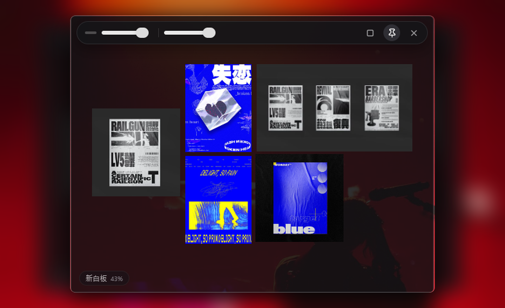

<p align="center">
  
</p>

<p align="center">
  <a href="README.md"><strong>English</strong></a> &nbsp;·&nbsp;
  <a href="README.zh-TW.md">繁體中文</a> &nbsp;·&nbsp;
  <a href="README.ja.md">日本語</a>
</p>

<p align="center">
  <a href="LICENSE"></a>
  <a href="https://github.com/Batkixni/Raglex/stargazers"></a>
  
  
  
  
</p>

<div align="center">
  <a href="https://awesomemygo.dev/apps/raglex">
    
  </a>
</div>

## Workspace Previews

| Frosted Glass Library & Inspector | Project Workspace & Board Previews |
| :---: | :---: |
|  |  |

| Infinite Moodboard Studio | Always-on-Top Floating Reference Window |
| :---: | :---: |
|  |  |

---

## Why Raglex?

**Raglex** is a fast, native desktop visual asset manager and infinite moodboard studio — built **100% local-first** with a **single local database** (`bbolt`) that stays completely yours on disk.

Built with **Go** and **[MyGo Native UI](https://github.com/egoist/mygo)** (`CGO_ENABLED=0`), Raglex starts instantaneously, runs smoothly across **macOS (Apple Silicon & Intel)**, **Windows (x64 & ARM64)**, and **Linux (x64 & ARM64)**, and ships in **English**, **Traditional Chinese (繁體中文)**, and **Japanese (日本語)**.

---

## Key Features

### Parallel Folders, Hierarchical Tags & Asset Stacks
- **Parallel Folders & Tags**: Organize your library using nested **Folders** and nested **Colored Tags** side by side — switch smoothly from the bottom-left gliding switcher, drag-and-drop assets to categorize, batch-delete folders with optional nested subfolder removal, and preserve full folder hierarchies when importing local directories.
- **Flexible Storage Modes**: Import by **Index** (leave files in place), **Symlink**, **Move**, or **Copy** — backed by live filesystem watching, automatic database snapshots (`raglex.db.bak`), and customizable sidebar top filters.
- **Editorial Layouts**: Switch effortlessly between **Bento**, **Waterfall Masonry**, and **Grid** views with real-time zoom, star ratings, and marquee rubber-band multi-selection.
- **Asset Stacks (`Ctrl+G`)**: Fold `poster_v1` / `poster_v2` / `poster_final` or multi-angle character sheets into a single tidy stacked card, or auto-group matching filenames in one click via `Ctrl+T`.

### Raglex Cloud, Selective Sync & Collaboration Spaces (v0.4.0)
- **20 GB Cloud Storage & High-Speed Sync**: Sign in to **Raglex Cloud** (or switch anytime to your own **Self-Host** Docker server) for 6-worker HTTP/2 delta sync with live sidebar progress and clear 20 GB quota monitoring.
- **Selective Folder Sync**: Under `Preferences → Sync & Collab`, choose exactly which folders upload to Cloud / Self-Host (excluding nested subfolders automatically) to save quota and bandwidth.
- **Team Collaboration Spaces (`CLB-XXXX-XXXX`)**: Share a reference Folder or Project with friends so everyone can contribute references together. **Per-user whiteboard ownership**: each member edits only their own whiteboards while viewing teammates' boards conflict-free.
- **Public Share Codes (`SHR-XXXX-XXXX`) & E2E Transfers**: Publish a Folder or Project to a public share code that anyone — even without a Raglex account — can paste and download, or transfer directly over LAN / E2E pairing codes.

### Native Designer Format Previews & Borderless Markdown Desk
Inspect and edit creative assets inline without leaving Raglex:
- **Borderless Markdown Desk**: Clean reading, split, and live editing modes with paragraph focus dimming, YAML frontmatter, tables, clickable task checkboxes, GitHub alerts, and `Ctrl+S` direct save.
- **Fonts (`.ttf` / `.otf`)**: Live custom preview text input, `24pt / 36pt / 48pt / 72pt` size switcher, full glyph waterfall, and `Aa` specimen thumbnails.
- **Audio (`.wav` / `.mp3` / `.flac` / `.ogg` / `.m4a` / `.aac`)**: Interactive 96-bar clickable waveform scrubber, direct playback, volume control, and waveform grid thumbnails.
- **SVG Vectors (`.svg`) & Multi-Page PDF (`.pdf`)**: Lossless GPU vector zoom (25% – 800%) with transparency checkerboard, plus page-by-page PDF navigation.
- **Images, RAW & Video**: Full-stage inline viewer with zoom, animated GIF & bundled `ffmpeg` video playback, and an **Info / Similar** Inspector sidebar.

### Moodboards & Always-on-Top Floating Reference Window
- **Standalone & Project Boards**: Create freeform infinite moodboards right from the sidebar or inside any project — drag assets, arrange groups, add sticky notes, vector arrows, section frames, pan, zoom, and rotate.
- **Always-on-Top Floating Reference Window**: Pop out any board into a frameless, always-on-top reference window with an auto-hiding HUD, adjustable **background & image opacity**, click-through lock, flip/grayscale checks, and fit (`F`).

### Local AI, Eagle Import, MCP & Ecosystem
- **Built-in Visual Search**: Pure-Go 128-dim visual embeddings, 64-bit pHash/dHash perceptual similarity, and 5-color OKLab palette search — works 100% offline.
- **One-Click In-App Laya / Ollaya Deployment**: Deploy and manage local open-source **Laya** decision models (`laya:multilingual`, `laya`, `winnow:e4b`) directly inside `Preferences → AI & Models`.
- **Official Eagle Import Plugin**: Import `.library` folders and `.eaglepack` archives via `+ Import → Import from Eagle`, preserving nested folders, tags, and web bookmarks with thumbnails.
- **Built-in Web Server (`raglex-server`) & MCP Server (`raglex-mcp`)**: Share dark-mode web galleries & `/mobile` PWA over LAN, or connect MCP-compatible AI assistants (17 tools).
- **Browser Companion Extension (`extensions/browser/` & `extensions/firefox/`)**: Clip images, screenshots, and bookmarks even when Raglex is closed via the offline drop folder.

---

## Keyboard Shortcuts

All shortcuts are customizable under `Preferences → Shortcuts` (automatically mapped between `Ctrl` and macOS `⌘`).

| Shortcut | Action |
| :--- | :--- |
| `Ctrl+T` / `Cmd+T` | Open Go to / Command Palette |
| `Ctrl+F` / `Cmd+F` | Focus Library Search |
| `Ctrl+I` / `Cmd+I` | Import Files |
| `Ctrl+A` / `Cmd+A` | Select All Visible Assets |
| `Ctrl+G` / `Cmd+G` | Group Selected Assets into a Version Stack |
| `F2` | Batch Rename Selection |
| `Ctrl+Z` / `Cmd+Z` | Undo Last Batch Rename |
| `Ctrl+C` / `Ctrl+V` | Copy OS Files / Paste Files or Clipboard Images |
| `Space` | Quick Look / Full Inline Asset Preview |
| `Ctrl+Alt+C` | Toggle Focus Mode |
| `Ctrl+Alt+G` | Toggle Grayscale Preview |
| `0` – `5` | Set Star Rating |
| `F` *(in Floating Ref)* | Fit All References to Window |
| `Esc` | Close Preview / Stack / Modal |

---

## Supported Platforms

| Platform | Architecture | Package |
| :--- | :--- | :--- |
| **macOS** | Apple Silicon (`darwin/arm64`) | `Raglex-darwin-arm64.zip` (`.app` bundle) |
| **macOS** | Intel x86_64 (`darwin/amd64`) | `Raglex-darwin-amd64.zip` (`.app` bundle) |
| **Windows** | x64 (`windows/amd64`) | `raglex-setup-0.4.1-amd64.exe` (Installer) / `Raglex-windows-amd64.zip` |
| **Windows** | ARM64 (`windows/arm64`) | `raglex-setup-0.4.1-arm64.exe` (Installer) / `Raglex-windows-arm64.zip` |
| **Linux** | x64 (`linux/amd64`) | `.tar.gz`, `.deb`, `.rpm`, `PKGBUILD` |
| **Linux** | ARM64 (`linux/arm64`) | `.tar.gz`, `.deb`, `.rpm`, `PKGBUILD` |

Download prebuilt releases from the [GitHub Releases](../../releases) page.

---

## Building from Source

Requires **Go 1.24+** (pure Go, `CGO_ENABLED=0` — cross-compile any desktop target from any OS!).

```bash
# Run the desktop app
go run ./cmd/raglex

# Build for your current platform
CGO_ENABLED=0 go tool mygo build -skip-installer

# Cross-compile for macOS (Apple Silicon & Intel), Windows (x64 & ARM64), and Linux (x64 & ARM64)
CGO_ENABLED=0 go tool mygo build -skip-installer -skip-dmg -skip-notarize \
  -platform "darwin/arm64,darwin/amd64,windows/amd64,windows/arm64,linux/amd64,linux/arm64"

# Build standalone VPS server CLI & MCP server
CGO_ENABLED=0 go build -trimpath -ldflags "-s -w" -o raglex-server ./cmd/raglex-server
CGO_ENABLED=0 go build -trimpath -ldflags "-s -w" -o raglex-mcp ./cmd/raglex-mcp

# Run static checks & test suite
go tool mygo vet .
CGO_ENABLED=0 go test -count=1 ./...
```

---

## Browser Companion Extension & Plugins

- **Chrome / Edge / Brave (Chromium)**: Open `chrome://extensions`, enable **Developer mode**, click **Load unpacked**, and select [`extensions/browser/`](extensions/browser/). Enable the Built-in Server under `Preferences → Web Clipper`.
- **Firefox / Zen Browser / Floorp / LibreWolf**: Open `about:debugging#/runtime/this-firefox` → **Load Temporary Add-on…** → select [`extensions/firefox/manifest.json`](extensions/firefox/manifest.json) (see [`extensions/firefox/README.md`](extensions/firefox/README.md) for `.xpi` setup).
- **Plugins**: Manage official and community plugins directly from `Preferences → Plugins`, or drop custom folders containing `manifest.json` into `<Library>/plugins/`.

---

## Contributing

Contributions are warmly welcomed! Please read [CONTRIBUTING.md](CONTRIBUTING.md) and [AGENT.md](AGENT.md) before opening a pull request.

## License

Raglex is licensed under the **[Mozilla Public License 2.0 (MPL-2.0)](LICENSE)**.
You are free to use, modify, and distribute Raglex under the terms of MPL-2.0; modifications to MPL-covered source files must remain available under MPL-2.0.
