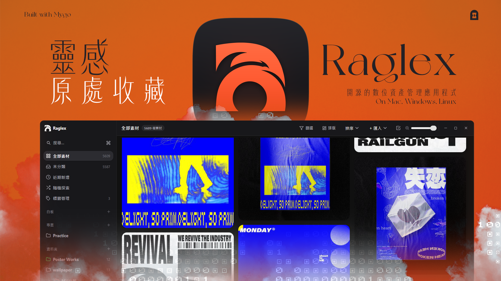
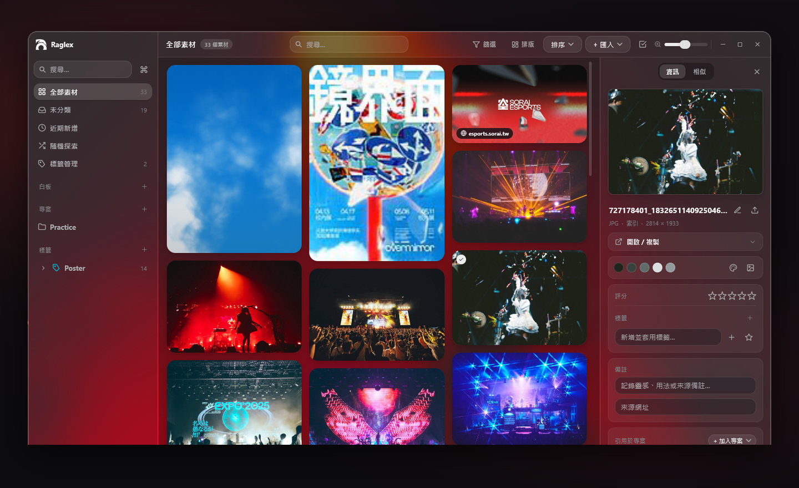
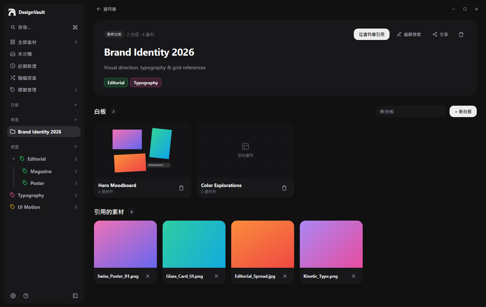
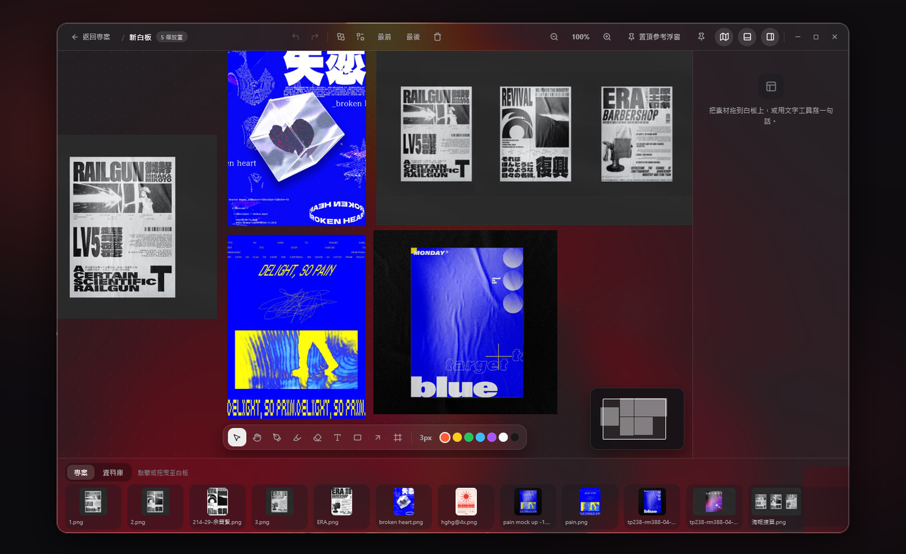
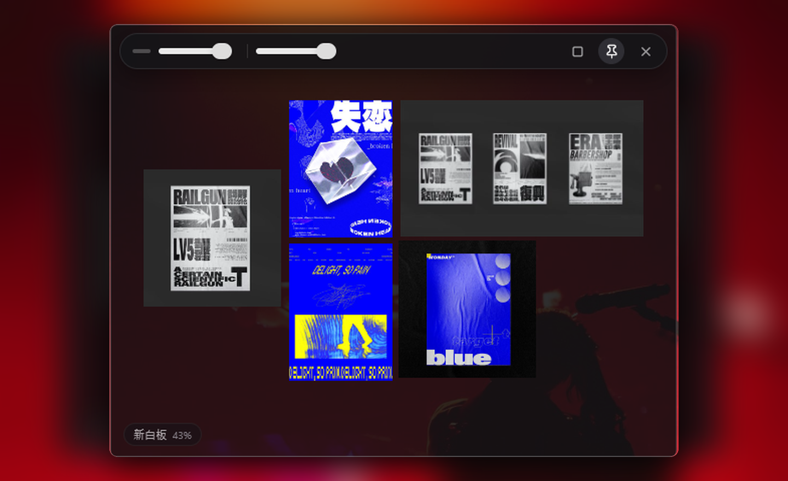

<p align="center">
  
</p>

<p align="center">
  <a href="README.md">English</a> &nbsp;·&nbsp;
  <a href="README.zh-TW.md"><strong>繁體中文</strong></a> &nbsp;·&nbsp;
  <a href="README.ja.md">日本語</a> &nbsp;·&nbsp;
  <a href="https://raglex.sorai.tw">官方網站</a> &nbsp;·&nbsp;
  <a href="https://raglex.sorai.tw/docs">使用文件</a>
</p>

<p align="center">
  <a href="LICENSE"></a>
  <a href="https://github.com/Batkixni/Raglex/stargazers"></a>
  
  
  
  
</p>

<div align="center">
  <a href="https://awesomemygo.dev/apps/raglex">
    
  </a>
</div>

<p align="center">
  <strong>開源、100% 純原生打造的視覺素材管理庫、本機 AI 以圖搜圖與無限參考白板 —— 以 Go + MyGo 開發。</strong><br/>
  零 Electron、預設索引不複製、零遙測追蹤，你的檔案永遠留在你自己的硬碟裡。
</p>

---

## 介面預覽

| 原生素材庫與右側檢閱欄 | 專案工作區與白板即時縮圖 |
| :---: | :---: |
|  |  |

| 無限靈感白板工作室 | 永遠置頂浮動參考視窗 |
| :---: | :---: |
|  |  |

---

## 核心特色

### 1. 100% 原生極速效能（拒絕 Electron）
- 以 **Go + [MyGo](https://github.com/egoist/mygo)** 與嵌入式 **bbolt** 編譯為單一 **約 21 MB 原生執行檔**，冷啟動極快、記憶體占用極低。
- 內建視窗虛擬化渲染，面對數萬筆素材依舊流暢捲動。
- 深度貼合各系統原生視覺：Windows 11 Acrylic 毛玻璃與 Snap Layouts、macOS Vibrancy 與原生視窗控制鍵、以及完整 Linux 支援。

### 2. 非破壞性「索引不複製」—— 檔案永遠屬於你
- **預設採用「索引（Index）」模式：完全不複製、不搬動你硬碟上的原始檔案**，零空間浪費、零封閉格式鎖死。
- 也支援依需求切換 **索引（Index）**、**捷徑連結（Symlink）**、**複製（Copy）** 與 **移動（Move）** 四種匯入策略。
- 預設刪除只移除資料庫索引，不動原始檔案；若真的想清理硬碟，刪除彈窗內提供明確勾選的**「同時永久刪除硬碟上的實體檔案」**防呆選項。

### 3. 無限參考白板 & 永遠置頂浮動參考視窗
- GPU 加速無限畫布，支援流暢縮放平移、多選對齊、群組、畫框（Frame）、手繪標記筆、箭頭與自動換行文字筆記。
- 隨時將白板彈出為**半透明永遠置頂浮動參考視窗**（可調透明度、縮放與灰階檢視），搭配 Blender、Photoshop、Figma、Clip Studio 創作超順手。

### 4. 本機視覺 AI Embedding 相似搜圖、主色票與離線 AI 自動標記
- **內建本機視覺 AI Embedding 引擎**：在你的電腦上直接計算圖片視覺特徵向量與感知雜湊，支援**以圖搜圖**與**尋找相似素材**，100% 離線執行。
- **OKLab 智慧主色票提取**：自動為每張素材分析 5 組代表色，點擊色點立即複製 HEX，或直接以顏色篩選全庫靈感。
- **選配本機 AI 自動分類（Ollama / Laya）**：可串接自己的本機視覺語言模型提供非侵入式標籤建議，圖片絕不外傳第三方雲端。

### 5. 平行階層資料夾、標籤樹、版本堆疊與全媒體支援
- **平行階層資料夾**與**階層標籤樹**（支援 8 色繼承與拖曳整理）、**版本堆疊（Stacks）**、**監控資料夾（Watch Folders）**自動收檔，以及支援即時預覽與復原的**規則式批次重新命名**。
- **Bento / 瀑布流 Masonry / 網格 Grid** 三種檢視、空白鍵快速預覽（Quick Look），並原生支援圖片、影片（**隨附靜態 `ffmpeg`**）、相機 RAW（`CR3`/`ARW`/`NEF`/`RAF`/`NAF`/`DNG`）、SVG、字型、音訊與 PDF。

### 6. 瀏覽器伴侶擴充（Chrome / Edge / Brave / Arc / Firefox / Zen）
- 網頁右鍵一鍵存圖並自動記錄來源網址與標題、批次掃描收集整頁圖片，並內建**離線收件資料夾**（即使沒開 Raglex 也能先存圖，下次啟動自動匯入）。
- 完整圖文說明：[`docs/BROWSER_EXTENSION.md`](docs/BROWSER_EXTENSION.md) · 線上文件：[raglex.sorai.tw/docs](https://raglex.sorai.tw/docs#extension)

### 7. Self-Host 自架零知識端對端加密同步 & 6 碼跨裝置傳檔
- 一行 Docker 指令即可在自家 NAS、家用主機或 VPS 架設完全屬於自己的開源同步伺服器（`deploy/docker-compose.yml` + `raglex-server`），同時支援 **Cloudflare R2 / S3 / MinIO**、手機 `/mobile` PWA 與 MCP Server。
- **預設開啟 AES-256-GCM 零知識端對端加密（E2EE）**：自動在本機產生 256-bit 隨機 AES 金鑰（`rglx-aes256-...`），所有個人同步檔案、檔名、標籤、資料夾與備註皆於本機加密後才上傳，並支援**另存金鑰檔 / 載入金鑰檔**方便多裝置安全復原。
- 內建**選擇性資料夾同步**、**智慧增量背景自動同步**（閒置輪詢僅 ~150 Bytes）與 **6 碼端對端加密 P2P 跨裝置傳檔**。
- 完整架設文件：[`docs/SELF_HOST.md`](docs/SELF_HOST.md) · 線上文件：[raglex.sorai.tw/docs](https://raglex.sorai.tw/docs#self-host)

### 8. 開放插件市集 & 本機 API / MCP
- 採用標準 stdin/stdout JSON 協議，可用任意語言（Go / Python / Node.js / Rust / PowerShell / Bash）開發插件（[`docs/PLUGIN_SDK.md`](docs/PLUGIN_SDK.md)），並透過社群 PR 市集 [`Batkixni/raglex-plugins`](https://github.com/Batkixni/raglex-plugins) 一鍵安裝。
- 內建多款選裝官方外掛：**Eagle Import**（`.library` / `.eaglepack` 匯入）、**Smart Duplicate Finder**、**Color Palette Exporter (CSS/JSON)**、**Auto Aspect Ratio & Resolution Tagger** 與 **Markdown Notes**。
- 內建受 Access Key 保護的本機伺服器（嚴格限制擴充套件與本機 CORS、`HttpOnly` 網頁圖庫／手機 PWA）與 AI Agent **MCP Server**。

---

## 下載與安裝

請前往 **[GitHub Releases](https://github.com/Batkixni/Raglex/releases/latest)** 或 **[raglex.sorai.tw](https://raglex.sorai.tw)** 下載對應版本：

| 平台 | 架構 | 檔案 |
| :--- | :--- | :--- |
| **Windows** | x64 (`windows/amd64`) | `raglex-setup-0.5.1-amd64.exe`（安裝版） / `Raglex-windows-amd64.zip` |
| **Windows** | ARM64 (`windows/arm64`) | `raglex-setup-0.5.1-arm64.exe`（安裝版） / `Raglex-windows-arm64.zip` |
| **macOS** | Apple Silicon (`darwin/arm64`) | `Raglex-darwin-arm64.zip` |
| **macOS** | Intel (`darwin/amd64`) | `Raglex-darwin-amd64.zip` |
| **Linux** | x64 / ARM64 | `.deb`、`.rpm`、`.tar.gz` |
| **瀏覽器擴充** | Chromium / Firefox & Zen | `raglex-browser-extension.zip` / `raglex-firefox-extension.xpi` |
| **自架伺服器 CLI** | Windows / macOS / Linux | `raglex-cli-<os>-<arch>.zip`（含 `raglex-server` 與 `raglex-mcp`） |

> [!NOTE]
> **關於 macOS 安全性提示與未簽章發行版（誠實說明）**
> 本專案 100% 採用 MPL-2.0 開源、**保證絕無任何惡意代碼與遙測追蹤**，所有發行檔皆由 GitHub Actions 公開自動編譯並附帶 `SHA256SUMS.txt`。
> 但因為個人開源專案目前沒有額外預算購買 Apple Developer 付費開發者憑證，**macOS 使用者在首次開啟時會看到系統跳出「無法驗證開發者 / 危險軟體或已損毀」的警告提示**，這不影響正常使用；將 `Raglex.app` 放入「應用程式」後執行以下指令即可正常啟動：
> ```bash
> xattr -cr /Applications/Raglex.app
> ```
> 若你對未簽章的預編譯執行檔有任何安全疑慮，非常歡迎直接檢閱原始碼並自行從原始碼編譯 —— 或者選擇不使用也沒關係，完全尊重你的安全考量。

---

## 瀏覽器擴充安裝教學

1. 開啟 **Raglex → 偏好設定 → 分享 / 進階**，啟動 **內建本機伺服器**（預設 Port `47595`）並點擊 **複製存取金鑰（Access Key）**。
2. 前往 [GitHub Releases](https://github.com/Batkixni/Raglex/releases/latest) 下載 `raglex-browser-extension.zip`（Chrome / Edge / Brave / Arc）或 `raglex-firefox-extension.xpi`（Firefox / Zen）。
3. **Chrome / Edge / Brave / Arc**：將 `.zip` 解壓縮到固定資料夾 → 開啟 `chrome://extensions`（Edge 為 `edge://extensions`）→ 開啟右上角 **開發人員模式** → 點擊 **載入未封裝項目** → 選擇剛解壓縮的資料夾。
4. **Firefox / Zen**：直接將 `.xpi` 拖入瀏覽器視窗安裝（或開啟 `about:debugging#/runtime/this-firefox` 臨時載入 `manifest.json`）。
5. 點擊瀏覽器工具列的 Raglex 圖示，貼上步驟 1 的 **Access Key** 看到綠燈連線即完成。離線收件資料夾設定請見 [`docs/BROWSER_EXTENSION.md`](docs/BROWSER_EXTENSION.md)。

---

## Self-Host 自架同步伺服器快速開始

```bash
git clone https://github.com/Batkixni/Raglex.git
cd Raglex/deploy
export RAGLEX_TOKEN="$(openssl rand -hex 32)"
docker compose up -d
```

接著在 **Raglex → 偏好設定 → 帳號與同步 → Self-Host** 填入伺服器網址（`http://<主機IP>:47595` 或 HTTPS 反代網址）與 `RAGLEX_TOKEN` 即可連線同步。完整 HTTPS 反代、R2/S3 儲存與 E2EE 金鑰備份步驟請見 [`docs/SELF_HOST.md`](docs/SELF_HOST.md)。

---

## 從原始碼自行編譯

需要 **Go 1.27+**，全平台皆可純 Go（`CGO_ENABLED=0`）建置：

```bash
git clone https://github.com/Batkixni/Raglex.git
cd Raglex
CGO_ENABLED=0 go tool mygo build -o build/dev
```

---

## 相關文件與隱私政策

- **官方網站與三語文件**：[raglex.sorai.tw](https://raglex.sorai.tw) · [raglex.sorai.tw/docs](https://raglex.sorai.tw/docs)
- **自架同步指南**：[`docs/SELF_HOST.md`](docs/SELF_HOST.md)
- **瀏覽器擴充指南**：[`docs/BROWSER_EXTENSION.md`](docs/BROWSER_EXTENSION.md)
- **插件開發 SDK**：[`docs/PLUGIN_SDK.md`](docs/PLUGIN_SDK.md) · **插件市集目錄**：[`Batkixni/raglex-plugins`](https://github.com/Batkixni/raglex-plugins)
- **設計規範**：[`DESIGN.md`](DESIGN.md) · **更新日誌**：[`CHANGELOG.md`](CHANGELOG.md) · **隱私權說明**：[`PRIVACY.md`](PRIVACY.md)

## 授權條款

採用 [Mozilla Public License 2.0 (MPL-2.0)](LICENSE) 開源授權。
