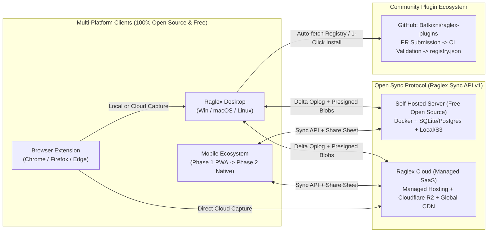

# Raglex Roadmap & Open-Core Ecosystem Plan

> **The Raglex Pledge (Ghost / WordPress Model)**
>
> **Forever Open Source. Forever Free Features.**
>
> Just like Ghost and WordPress, Raglex's desktop app, every core feature, the plugin SDK, and the self-hosted sync server are 100% open source and free—with zero artificial feature paywalls for self-hosters. Your creative library and files always belong to you in open local formats.
>
> **Raglex Cloud** (planned) will purely offer **managed cloud storage, zero-config multi-device sync, and hosted share links** for creators who prefer not to run their own servers—directly funding ongoing open-source development.

---

## System Architecture Vision

---

## Pillar 1 — Open Sync, Share & Managed Cloud (Self-Host + SaaS)

Upgrade the existing LAN share (`internal/share`) and built-in HTTP server (`internal/server`) into a rock-solid **Open Sync & Share Platform** where **Self-Hosted** and **Raglex Cloud** run the exact same open-source core.

### Technical Architecture
1. **Metadata Delta Sync (Append-Only Oplog)**
   - Logical clock (`HLC` + `device_id`) logging lightweight operations (`asset.upsert`, `asset.meta`, `asset.tag`, `project.ref`, `board.patch`, `asset.delete`).
   - Incremental endpoints: `GET /v1/sync/pull?since=<seq>` & `POST /v1/sync/push`.
   - Field-level Last-Write-Wins & set-union tag merging to prevent cross-device conflicts.
   - Optional client-side **End-to-End Encryption (E2EE)** mode.
2. **Content-Addressed Blob Sync (Zero-Egress Friendly)**
   - Reuse Raglex's existing **SHA-256** hashing via `POST /v1/blobs/check` so duplicate files are never re-uploaded.
   - Server issues **Presigned Upload/Download URLs** directly to **Cloudflare R2 / S3 / MinIO** so heavy media never bottlenecks the sync server and egress stays near zero.
   - **Smart Selective Sync**: Always sync lightweight thumbnails (~30–80 KB) first so 10,000+ asset libraries open in seconds on any device; stream/cache full originals on demand.
3. **Rich Public & Client Sharing**
   - Generate shareable web links for single assets, Projects, or full interactive Whiteboards.
   - Password protection, expiration dates, download permissions, and optional client feedback pins.

### Self-Hosted vs. Raglex Cloud

| Aspect | Self-Hosted (Forever Free) | Raglex Cloud (Managed SaaS) |
| :--- | :--- | :--- |
| **Feature Parity** | 100% identical—zero locked features | 100% identical |
| **Deployment** | `docker compose up -d` (NAS / VPS / Home Server) | Sign in and sync immediately |
| **Storage** | Your own disk, NAS, MinIO, S3, or R2 | Managed Cloudflare R2 object storage + automated backups |
| **Convenience** | Self-managed HTTPS, domain & backups | Automatic HTTPS, CDN share links, custom share domains |

---

## Pillar 2 — Community Plugin Ecosystem & GitHub PR Registry

Keep Raglex's core fast and focused (~21 MB single binary) by moving secondary workflows into an **Official Starter Plugin Ecosystem** that also serves as reference code for community authors.

### Registry Workflow (`Batkixni/raglex-plugins`)
1. Developers submit a PR adding `plugins/<plugin-id>/plugin.json` (metadata, release zip URL, SHA-256 checksum, required permissions, supported hooks).
2. GitHub Actions automatically validates schema, download reachability, SHA-256 integrity, and version compatibility.
3. Merging builds and publishes `registry.json` automatically.
4. Inside **Raglex → Preferences → Plugins**, the app fetches `registry.json` to offer an in-app **Discover & 1-Click Install / Update** marketplace with SHA-256 verification and explicit permission prompts.

### Planned Plugin SDK Hooks & Official Reference Plugins
- **Expanded Hooks**: `preview_renderer` (custom file previews), `inspector_card` (extra metadata cards), `importer` (external library/format importers), alongside existing `context_menu` and `batch_action`.
- **Official Starter Plugins**:
  - `raglex-markdown` — `.md` note import, preview rendering, and quick editing.
  - `raglex-eagle-importer` — 1-click migration from `.library` packages (folders, tags, notes, URLs).
  - `raglex-palette-export` — Export color palettes to CSS Variables, Tailwind, Figma JSON, and Adobe ASE.
  - `raglex-exif-inspector` — Camera EXIF metadata card in the right inspector.
  - `raglex-bg-remove` — Local/API background removal stacked automatically with the original image.

---

## Pillar 3 — Mobile Ecosystem (Powered by Sync API v1)

Once Pillar 1's open sync protocol is live, Mobile works seamlessly with **both Self-Hosted servers and Raglex Cloud**:

- **Phase 1 — Mobile-First PWA (Instant Launch, Zero Gatekeeping)**
  - Served directly from `raglex-server` / Raglex Cloud with "Add to Home Screen" support.
  - Fast thumbnail waterfall browsing, search/color/tag filtering, instant camera capture to library, and quick web URL bookmarking.
- **Phase 2 — Native iOS & Android Apps**
  - **OS Share Sheet Extension**: Clip references directly from Instagram, X, Pinterest, Safari, or Chrome straight into Raglex with tags.
  - **Offline Thumbnail Cache & Home Screen Inspiration Widget**.

---

## Pillar 4 — Brand, Distribution & Release Investments

- **Apple Developer Program (\$99/yr)**: Official macOS Developer ID **Codesigning & Notarization** (eliminates Gatekeeper warnings) + future iOS TestFlight / App Store distribution.
- **Windows Open-Source Code Signing**: Apply for **SignPath Foundation** free open-source signing to eliminate Windows SmartScreen warnings.
- **Website Homepage Redesign**: Interactive hero preview, 100% Open-Source Pledge, Ghost-style Self-Host vs. Raglex Cloud clarity, OS auto-detect download, and live plugin directory.
- **60–90s Launch Promo Video**: High-framerate showcase of Frosted Acrylic Glass, 100k-asset speed, Excalidraw Whiteboard, transparent PureRef window, clickable web bookmarks, and 17-tool MCP AI integration.

---

## Milestones

| Release | Focus |
| :--- | :--- |
| **`v0.2.1`** *(Current)* | Translucent glass inputs, auto-hide inspector, pixel-fitted preview, minimal viewer topbar, redesigned context menus, 17-tool MCP server, redesigned Preferences, interactive guided tour. |
| **`v0.3.0`** | **Plugin Ecosystem**: `Batkixni/raglex-plugins` PR registry, in-app 1-click plugin marketplace, `preview_renderer` / `inspector_card` / `importer` hooks, and official starter plugins (Markdown, Eagle importer, Palette export). |
| **`v0.4.0`** | **Open Sync & Mobile PWA**: `Raglex Sync API v1` (Oplog + SHA-256 Presigned R2/S3 blobs), Docker Compose self-hosting kit, public shareable projects/whiteboards, and mobile-first PWA. |
| **`v0.5.0`** | **Raglex Cloud Beta & Launch**: Managed cloud hosting beta, redesigned homepage, promo video, macOS notarization & Windows code signing. |
| **`v1.0.0`** | **Native Mobile Apps**: iOS & Android native apps with OS Share Sheet clipping and offline cache. |
